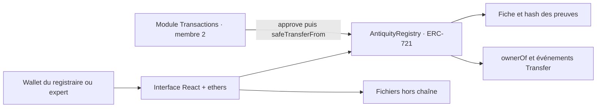

# Architecture du prototype

## Contrat commun proposé

- Un `tokenId` ERC-721 représente une antiquité. `ownerOf(tokenId)` est la source unique de propriété numérique.
- `registerAntique(initialOwner, name, origin, period, metadataURI, provenanceURI, evidenceHash)` comporte exactement sept arguments dans cet ordre. Seul `REGISTRAR_ROLE` peut l'appeler.
- `getAntique(tokenId)` lit la fiche initiale et l'attestation. `tokenURI(tokenId)` lit les métadonnées externes.
- `verifyAntique(tokenId)` enregistre une seule attestation par un compte doté de `EXPERT_ROLE`.
- `AntiqueRegistered`, `AntiqueVerified` et `Transfer` permettent de reconstruire la chronologie. Toutes les mutations de propriété, même directes, sont dans les logs `Transfer` du Registry.
- Le module Transactions doit recevoir une approbation ERC-721 via `approve` ou `setApprovalForAll`. Son appel au Registry aura le contrat Transactions comme `msg.sender`. Aucun rôle administrateur n'est nécessaire pour transférer.

## Stockage et limites

Le contrat conserve les déclarations d'origine et de période, l'URI de provenance, le hash Keccak-256 du fichier de preuve et l'attestation. Les photos et rapports restent hors chaîne. Les URI et la fiche initiale ne disposent d'aucune fonction publique de modification. Une URI pointant vers un contenu mutable peut néanmoins changer hors chaîne ; privilégier des URI de contenu comme IPFS.

`verified` indique seulement qu'un expert autorisé a enregistré une attestation. Ni l'authenticité physique, ni la propriété juridique, ni la qualification réelle du wallet expert ne sont vérifiées automatiquement. `block.timestamp` sert à situer l'attestation dans la chronologie du réseau.

**À valider avec le membre 2 avant l'intégration :** signatures ci-dessus, modèle de vente, usage précis des approbations et stratégie d'indexation des événements. Le module Transactions n'est pas encore présent dans ce dépôt.
